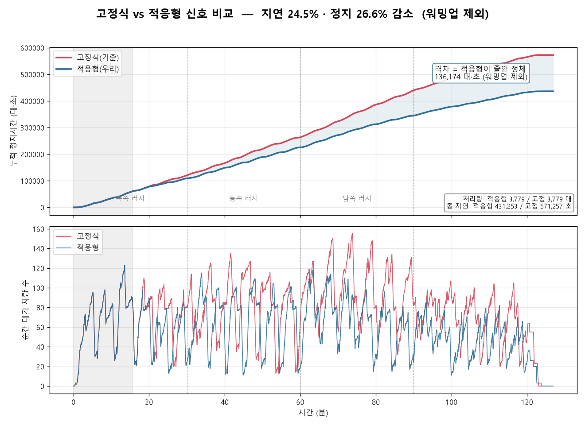
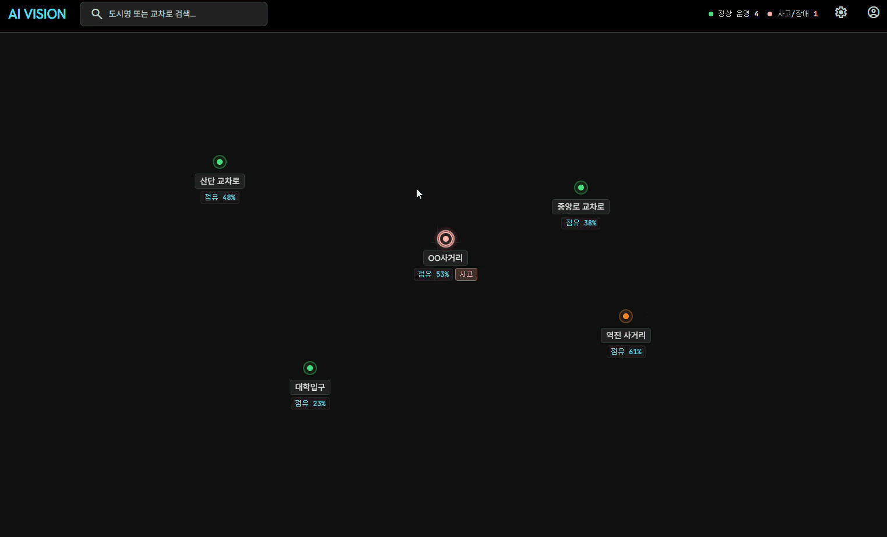
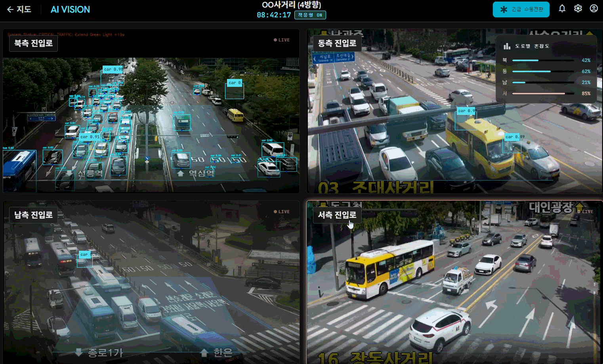

# SIX SENSE — 차량 감지 기반 적응형 신호 제어

교차로 진입로의 혼잡도(점유율)를 측정해 **방향별 녹색 신호 시간을 3사이클마다 다시 배분**하는 적응형 신호 제어 알고리즘입니다.
교통 시뮬레이터 **SUMO**에 TraCI로 연결해, 같은 차량 수요에서 고정식 신호와 나란히 돌려 성능을 비교했습니다.

> AI 부트캠프 팀 프로젝트 (6인) · 2026.07.20 ~ 07.24
> 이 저장소는 그중 **제가 맡은 신호 배분 알고리즘과 SUMO 시뮬레이션 검증 코드**를 정리한 것입니다.

<p align="center">
  
</p>

## 결과 요약

같은 차량 수요(2시간, 30분마다 붐비는 방향이 북→동→남→서로 바뀌는 시나리오)를 두 신호 방식에 똑같이 넣고 비교했습니다.
두 방식이 똑같이 동작하는 첫 블록(워밍업 936초)에 출발한 차량은 집계에서 뺐습니다.

| 지표 | 고정식 | 적응형 | 변화 |
|---|---:|---:|---:|
| 처리량 (통과 차량 수) | 3,779대 | 3,779대 | 동일 |
| 총 지연 (SUMO `timeLoss` 합) | 571,257초 | 431,253초 | **24.5% 감소** |
| 1대당 평균 지연 | 151.2초 | 114.1초 | −37.1초 |
| 진입로 누적 정지시간 | — | — | **26.6% 감소** (136,174대·초) |

- 근거 데이터: [`results/tripinfo_fixed.xml`](results/tripinfo_fixed.xml), [`results/tripinfo_adaptive.xml`](results/tripinfo_adaptive.xml), [`results/comparison.png`](results/comparison.png)
- 처리량을 함께 본 이유: 신호를 잘못 줘서 차를 덜 들여보내도 대기열 지표는 좋아 보일 수 있습니다. 처리량이 같아야 지연 감소를 개선으로 볼 수 있습니다.
- 이 수치는 임시 설정값과 한 가지 시나리오(시드 42)에서 나온 결과입니다. 비교 조건 차이 등 해석할 때 주의할 점은 [한계](#한계와-개선-방향)에 정리했습니다.

## 담당 역할

팀은 6명이었고, 영상에서 차량을 감지하는 AI 비전 모델은 다른 팀원이 맡았습니다. 저는 아래 부분을 맡았습니다.

| 담당 | 내용 | 코드 |
|---|---|---|
| 신호 배분 알고리즘 | 보행 고정 → 최소 시간 보장 → 수요 비례 배분 → 최대 시간 제한, 3사이클 롤링 윈도우 | [`signal_allocation.py`](signal_allocation.py) |
| SUMO·TraCI 연동 | 5현시 신호 프로그램 자동 생성, 150m 점유율 측정, 블록마다 재배분 | [`sumo_runner.py`](sumo_runner.py) |
| 성능 검증 | 고정식·적응형 동시 실행, 처리량·timeLoss·워밍업 제외 지표, 비교 그래프 | [`compare_runner.py`](compare_runner.py) |
| 시험용 교차로 | 4방향 3차로 교차로 네트워크 직접 정의 | [`sumo/cross.nod.xml`](sumo/cross.nod.xml), [`sumo/cross.edg.xml`](sumo/cross.edg.xml) |
| 관제 대시보드 | 화면 흐름과 UI/UX 설계 ([아래](#관제-대시보드-uiux-설계) 참고, 코드는 이 저장소에 없음) | — |

## 알고리즘

### 현시 구성과 롤링 윈도우

- **5현시**: 방향 1~4(북·동·남·서) 차량 현시(직진+좌회전) + 보행자 현시(모든 방향 동시 횡단). 차량 현시 뒤에는 황색 3초가 들어갑니다.
- **3사이클 = 1블록**: 한 블록 동안 수요를 모으고, 블록이 끝나면 그 값으로 다음 블록의 녹색 시간을 정합니다. 신호가 너무 자주 바뀌지 않게 하면서 바뀌는 교통 흐름을 따라가기 위한 선택입니다.
- 첫 블록은 참고할 데이터가 없어서 기준값(방향별 60초)으로 시작합니다.

### 배분 규칙 — [`allocate_from_demand()`](signal_allocation.py#L88)

한 사이클의 녹색 시간 총량(300초)은 고정하고, 그 안에서 나눕니다.

1. **보행자 30초 고정**: 보행 시간은 사람 수가 아니라 횡단거리 ÷ 보행속도로 정해지므로 수요와 관계없이 먼저 떼어 둡니다.
2. **최소 시간 보장**: 남은 270초 중 차량 4방향에 40초씩 먼저 줍니다.
3. **수요 비례 배분**: 나머지 110초를 방향별 수요 비율대로 나눕니다.
4. **최대 시간 제한**: 한 방향이 80초를 넘지 않게 자릅니다.

수요가 전혀 없으면 기준값(60초)으로 돌아갑니다. 이 함수는 수요의 **비율만** 쓰기 때문에, 입력 단위가 차량 대수(파이썬 시뮬레이션)든 점유율 %(SUMO)든 같은 코드를 그대로 씁니다.

### 수요 측정 — [`occupancy_150m()`](sumo_runner.py#L275)

- **무엇을**: 정지선에서 뒤로 150m 구간 안에 있는 차량 길이의 합 ÷ 구간 길이(차로 평균)를 점유율(%)로 씁니다.
- **언제**: 각 방향이 자기 녹색이 아닌 동안 10초마다 점유율을 재고, 녹색이 켜지는 순간 그 샘플들의 평균을 그 사이클 값으로 확정합니다. 블록이 끝나면 3사이클 값을 다시 평균 냅니다(이중 평균).
- SUMO에서는 카메라 대신 시뮬레이터에서 점유율을 직접 읽습니다. 실제 시스템에서는 이 자리에 AI 비전의 감지 결과가 들어가는 구조입니다.

### SUMO 신호 프로그램 자동 생성 — [`build_program()`](sumo_runner.py#L221)

SUMO가 기본으로 만드는 신호는 5현시 설계와 달라서, TraCI `setProgramLogic`으로 9단계(4방향 × 녹색·황색 + 보행) 프로그램을 직접 만들어 설치합니다.

- 신호 상태 문자열은 손으로 쓰지 않고, 신호등이 제어하는 링크 구조(`getControlledLinks`)를 읽어 진입 도로별로 묶어 자동으로 만듭니다.
- 차량 진입 도로에 속하지 않는 링크는 횡단보도로 판단합니다.
- 우회전 링크를 자동으로 찾아 모든 단계에서 양보 녹색(`g`)을 줘, 한국식 우회전 상시 통행을 반영했습니다.

## 실행 방법

**준비**: [SUMO](https://eclipse.dev/sumo/) 설치(검증 당시 1.27.1), `SUMO_HOME` 환경 변수 등록, `sumo`·`sumo-gui`를 PATH에 추가, `pip install -r requirements.txt`

```bash
# 1) 파이썬 간이 시뮬레이션 (SUMO 없이 실행 가능, 고정식 vs 적응형 50회 반복)
python signal_allocation.py

# 2) SUMO에서 적응형 신호만 실행 (sumo-gui 창이 열림)
python sumo_runner.py

# 3) 고정식 vs 적응형 동시 비교 → comparison.png, tripinfo_*.xml 생성
#    GUI 없이 빠르게 돌리려면 compare_runner.py 의 HEADLESS 를 True 로 변경
python compare_runner.py
```

- 모든 명령은 저장소 루트에서 실행합니다. SUMO 입력 파일 경로가 루트 기준(`sumo/...`)으로 지정되어 있습니다.
- 차량 수요 파일(`sumo/intersection.rou.xml`)은 2)·3)을 실행할 때 [`SCENARIO_SCHEDULE`](signal_allocation.py)로부터 자동 생성됩니다. 시나리오를 바꾸려면 이 값만 고치면 파이썬 시뮬레이션과 SUMO에 함께 반영됩니다.
- 1)의 파이썬 시뮬레이션은 차량 대수 기반의 단순 대기열 모델이라, 정식 성능 수치가 아니라 배분 로직이 올바른 방향으로 동작하는지 점검하는 용도로 썼습니다.

<details>
<summary>교차로·보행자 파일을 다시 만들 때 (선택)</summary>

저장소에 포함된 `sumo/intersection.net.xml`, `sumo/intersection.ped.rou.xml`은 아래 명령으로 생성했습니다(파일 헤더에 기록된 옵션 기준).

```bash
cd sumo
netconvert --node-files cross.nod.xml --edge-files cross.edg.xml \
  --no-turnarounds --sidewalks.guess --crossings.guess --walkingareas \
  -o intersection.net.xml

python "$SUMO_HOME/tools/randomTrips.py" -n intersection.net.xml \
  --persons -e 7200 --period 4.0 -r intersection.ped.rou.xml
```
</details>

## 프로젝트 구조

```
six-sense/
├── signal_allocation.py      # 배분 알고리즘 + 파이썬 간이 시뮬레이션 + 시나리오 정의
├── sumo_runner.py            # SUMO 연동: 신호 프로그램 생성, 점유율 측정, 블록마다 재배분
├── compare_runner.py         # 고정식/적응형 SUMO 2개 동시 실행, 지표 집계, 그래프 저장
├── sumo/                     # SUMO 입력 파일
│   ├── intersection.sumocfg      # SUMO 실행 설정 (2시간)
│   ├── cross.nod.xml / cross.edg.xml   # 4방향 3차로 교차로 정의
│   ├── intersection.net.xml      # 위 정의로 생성한 SUMO 네트워크
│   ├── intersection.ped.rou.xml  # 보행자 수요
│   └── gui-settings.xml          # sumo-gui 표시 설정
├── results/                  # README 수치의 근거 (비교 그래프, tripinfo)
└── docs/
    ├── DEVELOPMENT.md        # 개발 과정: 부딪힌 문제와 해결 과정
    ├── initial_design.md     # 첫날 작성한 초기 설계 메모 (보존용)
    └── images/               # 대시보드 설계 화면
```

## 한계와 개선 방향

- **비교 조건 차이**: 고정식 기준선은 기준값(`DEFAULT_GREEN`)을 그대로 써서 보행자 현시가 60초이고, 적응형은 첫 재배분부터 보행자 현시가 30초입니다. 사이클 총량(300초)은 같지만 적응형이 차량에 30초를 더 쓰므로, 개선분 중 일부는 배분 방식이 아니라 이 차이에서 나왔을 수 있습니다. 보행 시간을 같게 맞춘 기준선으로 다시 비교해야 순수한 배분 효과를 분리할 수 있습니다.
- **최대 시간 제한 후 남는 시간**: 80초로 자른 초과분을 다른 방향에 다시 나누지 않아서, 사이클 차량 녹색 합이 270초보다 조금 짧아질 수 있습니다(예: 69+56+61+80=266초). 코드에 TODO로 남겨 둔 부분입니다.
- **검증 범위**: SUMO 결과는 한 가지 시나리오·한 번의 실행입니다. 여러 시드와 교통 패턴으로 반복해 분포를 봐야 합니다.
- **설정값**: 기준·최소·최대 녹색 시간, 황색, 보행 시간은 현장 실측 전의 임시값입니다(코드의 `[TODO]`).
- **측정**: 150m 검지 구간을 넘어서는 대기열(스필백)은 점유율에 잡히지 않습니다. 또한 SUMO에서는 점유율을 시뮬레이터에서 직접 읽었고, 실제 AI 비전 감지 결과와 연결해 검증하지는 않았습니다.

## 관제 대시보드 UI/UX 설계

관제자가 지도에서 교차로 상태를 보고, 4방향 CCTV와 개별 카메라로 내려가며 확인하는 화면 흐름을 설계했습니다. 대시보드 구현 코드는 이 저장소에 포함되어 있지 않습니다.

| 통합 관제 지도 | 4방향 CCTV + 방향별 혼잡도 |
|---|---|
|  |  |

- 지도에서 교차로별 상태(정상·혼잡·사고)와 점유율(%)을 표시합니다.
- CCTV 화면에서 방향별 혼잡도를 보여 주며, 이 점유율이 신호 배분 알고리즘의 입력이 되는 구조입니다.

## 기술 스택

Python 3 · SUMO 1.27.1 / TraCI · matplotlib

## 더 보기

- [개발 과정 (DEVELOPMENT.md)](docs/DEVELOPMENT.md): 차량 대수 → 점유율, 순간값 → 빨간 구간 평균, 실제 도로(OSM) → 직접 정의한 교차로 등 설계를 바꾼 이유
